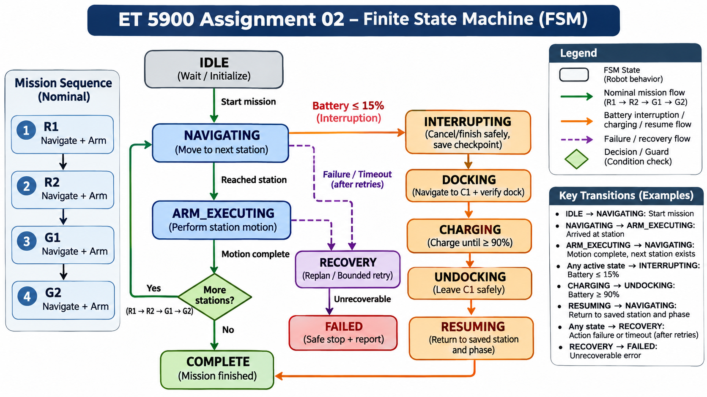
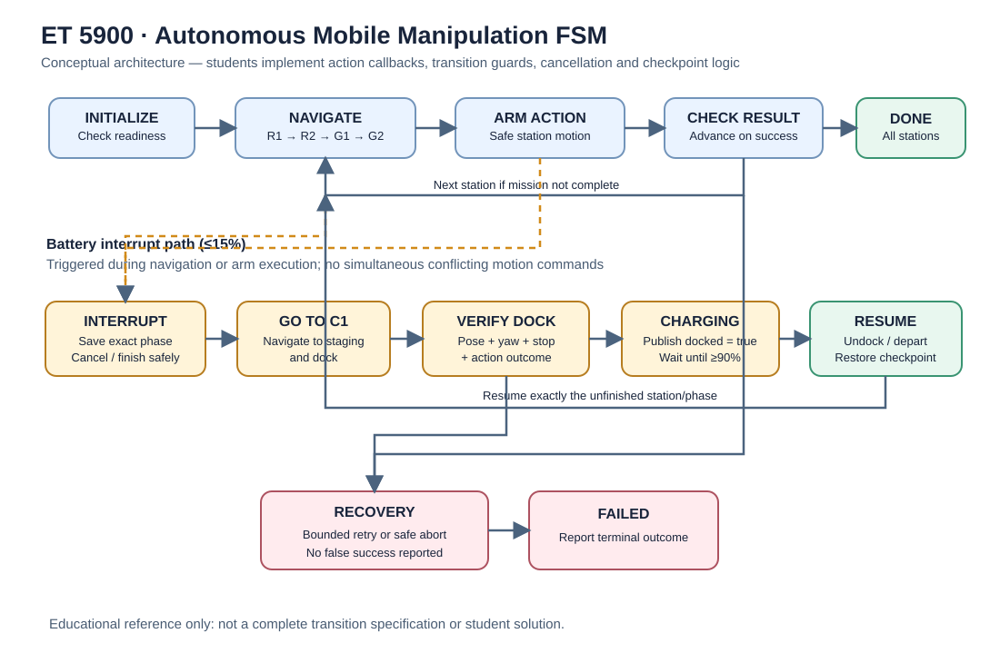
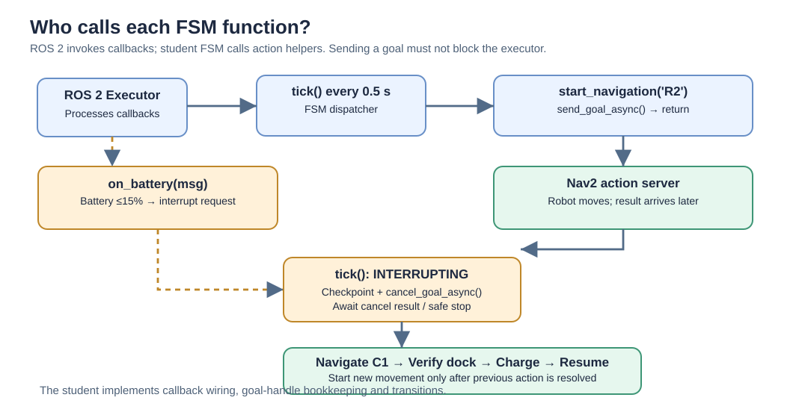

# ET 5900 - Assignment 02: Finite-State Machine for Mobile Manipulation

**Course:** ET 5900 - Multi-Robot Systems  
**Robot:** TurtleBot 4 Lite + SO-ARM101  
**Software:** Ubuntu 24.04 · ROS 2 Jazzy · Gazebo Harmonic · Nav2 · MoveIt 2

> **Students: Start with the [Assignment Requirements](docs/STUDENT_ASSIGNMENT_FINAL.md), then follow the [Installation Guide](docs/STUDENT_INSTALLATION.md).** Use the [ROS 2 Command Reference](docs/ROS2_COMMAND_REFERENCE.md) as you implement your controller. A video instructions are provided also in the Canvas.

## Assignment overview

Design, implement, and demonstrate a **finite-state-machine (FSM) controller** for a simulated TurtleBot 4 Lite carrying a SO-ARM101 robotic arm. The robot must visit four manufacturing stations in sequence, execute safe arm motions at each station, respond to a low-battery interruption, dock at a charging station, and resume its unfinished task correctly.

**Physical object grasping is not required.** Simulated, collision-safe arm motions represent pickup and placement operations. Use MoveIt 2's **Joints** tab to discover, plan, and validate appropriate motions at each station.

### Mission sequence

| Order | Station | Operation |
|---|---|---|
| 1 | **R1** | Red pickup: navigate and perform arm motion |
| 2 | **R2** | Red placement: navigate and perform arm motion |
| 3 | **G1** | Green pickup: navigate and perform arm motion |
| 4 | **G2** | Green placement: navigate and perform arm motion |
| Interrupt | **C1** | Dock, charge, and resume interrupted mission phase |

### Low-battery and docking requirements

1. Continuously monitor `/battery_state` (its `percentage` value is a fraction, e.g. `0.15` = 15%).
2. At **≤15%**, safely interrupt the current activity, handle in-progress action cancellation, and save the **exact unfinished task phase**.
3. Navigate to **C1** and perform an explicit docking stage. A successful navigation result alone is **not** proof of docking.
4. Independently verify docking using pose, orientation, stationary odometry, and relevant action results *before* setting `/virtual_charger/docked` to `true`.
5. Charge to **≥90%**, disable charging, undock/depart safely, and resume the saved phase without skipping or duplicating completed work.
6. Implement safe timeouts, bounded retries, action result handling, recovery, and an explicit failure outcome.

**Docking note:** C1 is a virtual dock in this workcell, not a configured physical contact-docking plugin. The starter exposes Nav2 `DockRobot`/`UndockRobot` clients, but their presence does not imply that C1 is registered with a Nav2 docking server. Follow the virtual-docking criteria described in the assignment.



## What is provided — and what you must implement

| Provided in repository | Student implementation |
|---|---|
| Combined robot model and Gazebo controllers | Mission FSM state/transition logic |
| Saved occupancy map and station configuration | Correct Nav2 action sequencing and preemption |
| Nav2 velocity bridge and station markers | Collision-safe arm motions selected using MoveIt 2 |
| Virtual battery and charging interface | Battery interruption and checkpoint semantics |
| ROS 2 action clients and starter code | Docking verification, charging decisions, and resume |
| Tutorials and example ROS CLI commands | Error recovery, reporting, testing and analysis |

The supplied [`student_fsm.py`](src/tb4_fsm_assignment/tb4_fsm_assignment/student_fsm.py) is **intentionally incomplete**. It should start without autonomously moving the robot or turning on charging. Filling in the TODOs, including asynchronous ROS 2 behavior and recovery, is part of the assignment.

## Repository navigation

```text
ET5900-Assignment02-FSM/
├── README.md
├── docs/
│   ├── STUDENT_ASSIGNMENT_FINAL.md    # Tasks, deliverables, rubric
│   ├── STUDENT_INSTALLATION.md        # Complete setup guide
│   └── ROS2_COMMAND_REFERENCE.md      # Manual base/arm/action examples
├── src/
│   ├── tb4_so101_description/         # Robot URDF, controllers, Gazebo launch
│   ├── tb4_so101_moveit_config/       # MoveIt configuration and launch
│   ├── tb4_virtual_battery/           # Battery simulator
│   └── tb4_fsm_assignment/            # FSM skeleton, bridge, station markers
├── maps/
│   ├── week9_pick_place.yaml
│   └── week9_pick_place.pgm
├── worlds/
│   └── week9_pick_place.sdf
├── patches/
│   └── so101_gripper_dynamics.patch
└── scripts/
    ├── start_component.sh            # Component startup menu
    └── release_preflight.sh          # Asset presence check
```

### Document and source shortcuts

| Goal | Link |
|---|---|
| Read tasks, **undergraduate vs graduate expectations**, deliverables, and grading | [Student Assignment](docs/STUDENT_ASSIGNMENT_FINAL.md) |
| Follow installation and workspace setup | [Student Installation](docs/STUDENT_INSTALLATION.md) |
| Learn `ros2 topic pub`, Nav2 actions, and arm joint trajectory commands | [ROS 2 Command Reference](docs/ROS2_COMMAND_REFERENCE.md) |
| Implement the FSM | [student_fsm.py](src/tb4_fsm_assignment/tb4_fsm_assignment/student_fsm.py) |
| Check coordinates for R1, R2, G1, G2, C1 | [stations.yaml](src/tb4_fsm_assignment/config/stations.yaml) |
| Record 4 safe joint targets | [arm_poses_TEMPLATE.yaml](src/tb4_fsm_assignment/config/arm_poses_TEMPLATE.yaml) |
| Inspect robot integration | [Robot Gazebo Launch](src/tb4_so101_description/launch/tb4_so101_gazebo.launch.py) |
| Inspect MoveIt integration | [MoveIt Launch](src/tb4_so101_moveit_config/launch/moveit.launch.py) |
| Inspect the workcell | [Gazebo SDF](worlds/week9_pick_place.sdf) |


### How does the FSM execute different states?

The FSM uses a periodic ROS 2 timer:

```python
self.timer = self.create_timer(0.5, self.tick)
```

ROS 2 automatically invokes `tick()` approximately every 0.5 seconds.

Students must implement the state dispatcher and transitions.

**Conceptual example (not a complete FSM):**

```python
def tick(self):

    if self.state == MissionState.IDLE:
        self.state = MissionState.NAVIGATING
        self.start_navigation('R1')

    elif self.state == MissionState.NAVIGATING:
        # Monitor navigation events and action results.
        pass

    elif self.state == MissionState.INTERRUPTING:
        # Begin or continue a safe interruption.
        pass

    elif self.state == MissionState.DOCKING:
        # Begin or monitor C1 docking.
        pass

    elif self.state == MissionState.CHARGING:
        # Monitor battery percentage.
        pass
```

**Important:** `tick()` does not automatically cycle through all states. Only the branch matching `self.state` executes.

Students must design:
- When to enter and leave each state.
- Which function to call upon entering a state.
- How to avoid sending duplicate goals on every timer tick.
- How ROS 2 action callbacks report success, cancellation, and failure.
- How battery events trigger interruption and mission resumption.

All long-running robot operations must use nonblocking ROS 2 actions so battery monitoring remains responsive.

## FSM Architecture and Asynchronous Execution

### Complete Mission FSM

The robot follows R1 → R2 → G1 → G2 and interrupts the mission
when the battery falls to 15% or below.



### How Function Calls and Interruption Work

ROS 2 invokes timer and subscription callbacks automatically.
Students must implement the FSM function calls, asynchronous
goal handling, cancellation and task resumption.




## Dependencies

The instructor-tested environment is **Ubuntu 24.04 LTS, ROS 2 Jazzy, and Gazebo Harmonic (Gazebo Sim 8)**. Students also need:

- **TurtleBot 4 Lite simulation** packages and their ROS–Gazebo bridge.
- **SO-ARM101 ROS 2**: [adoodevv/so101_ros2](https://github.com/adoodevv/so101_ros2) at commit **`3fb5182614b8e672ab8784b2a10b50656f976c9c`**.
- This repository's [SO-ARM101 gripper patch](patches/so101_gripper_dynamics.patch), applied to the pinned upstream checkout **before building**.
- **Nav2**, AMCL, map server, TF2, **MoveIt 2**, `ros2_control`, Gazebo ROS integration, `colcon`, `rosdep`, and package-declared Python dependencies such as PyYAML.

The SO-ARM101 dependency's upstream [README](https://github.com/adoodevv/so101_ros2) documents its Gazebo, ros2_control, and MoveIt requirements. For complete dependency installation and build order, **follow the [Student Installation Guide](docs/STUDENT_INSTALLATION.md)**; cloning this assignment alone does not install its upstream dependencies.

### Clone this assignment

```bash
cd ~
git clone https://github.com/apandastider/ET5900-Assignment02-FSM.git et5900-fsm-assignment
cd ~/et5900-fsm-assignment
```

### Install the pinned SO-ARM101 source (after ROS 2 prerequisites)

```bash
mkdir -p ~/so101_jazzy_ws/src
cd ~/so101_jazzy_ws/src
git clone https://github.com/adoodevv/so101_ros2.git
cd so101_ros2
git checkout 3fb5182614b8e672ab8784b2a10b50656f976c9c
git apply ~/et5900-fsm-assignment/patches/so101_gripper_dynamics.patch

cd ~/so101_jazzy_ws
source /opt/ros/jazzy/setup.bash
rosdep install --from-paths src --ignore-src -r -y
colcon build --symlink-install
```

### Build assignment packages (after TurtleBot and SO-101 installation)

```bash
mkdir -p ~/et5900_student_ws/src
cp -a ~/et5900-fsm-assignment/src/. ~/et5900_student_ws/src/
source /opt/ros/jazzy/setup.bash
source ~/turtlebot4_ws/install/setup.bash
source ~/so101_jazzy_ws/install/setup.bash
cd ~/et5900_student_ws
rosdep install --from-paths src --ignore-src -r -y
colcon build --symlink-install
source install/setup.bash
```

This example assumes the TurtleBot simulation workspace is named `~/turtlebot4_ws`. If yours differs, follow the installation guide and source your actual workspace. The world-file lookup and map setup must also be completed before launch.

## Startup and quick checks

**Start components in this order** in separate terminals: (1) Gazebo, (2) ROS–Gazebo bridge, (3) AMCL with saved map, (4) Nav2, (5) assignment infrastructure, (6) RViz, (7) virtual battery, and (8) MoveIt as needed.

The provided component menu is:

```bash
cd ~/et5900-fsm-assignment
bash scripts/start_component.sh menu
```

Each menu selection runs a long-lived process: **open a new terminal** for the next component. The launcher assumes correctly installed/sourced dependencies; see the [installation document](docs/STUDENT_INSTALLATION.md) for the full procedure.

Useful commands once the environment is running:

```bash
ros2 control list_controllers
ros2 action list | grep -E 'navigate_to_pose|follow_joint_trajectory|dock|undock'
ros2 topic info /battery_state
ros2 topic info /fsm/station_markers
```

Run the incomplete student FSM (after sourcing your assignment workspace):

```bash
ros2 run tb4_fsm_assignment student_fsm --ros-args -p use_sim_time:=true
```

The starter is **not supposed to complete the mission** until you implement the missing logic.

## Manual ROS 2 commands and motion planning

Use the [ROS 2 Command Reference](docs/ROS2_COMMAND_REFERENCE.md) to practice:

- **Base:** publish `geometry_msgs/msg/TwistStamped` to `/diffdrive_controller/cmd_vel` in a controlled test, or navigate using Nav2 `/navigate_to_pose`.
- **Arm:** submit `control_msgs/action/FollowJointTrajectory` goals to `/arm_controller/follow_joint_trajectory`.
- **MoveIt:** use the **Joints** tab to plan and validate collision-safe station-specific arm poses.
- **Battery:** inspect `/battery_state`; test `/virtual_charger/docked` only after independent docking verification.

Never send manual base velocity commands concurrently with an active Nav2 goal. Direct arm trajectories do not automatically perform collision-aware planning.

## Submission, grading, and help

The [Student Assignment](docs/STUDENT_ASSIGNMENT_FINAL.md) is authoritative for the **grading rubric, individual deliverables, report requirements, undergraduate/graduate distinctions, and due date**. The FSM skeleton alone is not an answer or an acceptable submission.

If something fails, record the exact command, complete error output, active ROS nodes/controllers, and the action you were trying to perform. Common checks include AMCL initial pose in RViz, `map → odom → base_link` TF availability, controller activation, sensor bridge topics, and whether the virtual battery node is running.

> **Validation scope:** The custom packages, selected component launches, navigation-to-C1, and virtual charging were verified on the instructor's Ubuntu 24.04/Jazzy system. A from-scratch installation on every student machine has **not** been independently validated.
